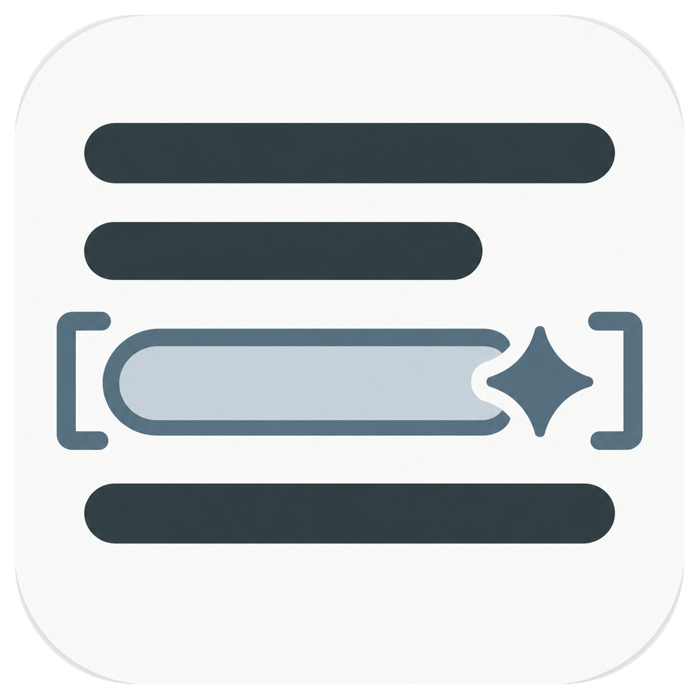

<p align="center">
  
</p>

<h1 align="center">LLM Reader</h1>

<p align="center">本地优先的 Windows 桌面阅读器：连续阅读，用原文核对每次理解。</p>

<p align="center">
  <a href="https://apps.microsoft.com/detail/9PL7FB24VJMV">商店购买</a>
  ·
  <a href="docs/manual/build-from-source.md">从源码构建</a>
  ·
  <a href="https://llm-reader.maaoding.icu/">项目主页与交互演示</a>
  ·
  <a href="https://llm-reader.maaoding.icu/docs/">使用文档</a>
</p>

当前 Microsoft Store 版（AppX **1.4.0.0**）支持摘录整理、会话 Markdown 导出与书库备份。[历史 GitHub 安装版 v1.4.0 发布说明](https://llm-reader.maaoding.icu/docs/releases/v1.4.0.html)

开发版已加入书内引用预览、跨书搜索最近对话和阅读页按含义查找。[开发进展与使用方法](https://llm-reader.maaoding.icu/docs/changelog.html#开发版)

## 核心功能

- **连续阅读**：支持 EPUB、UTF-8 TXT 与 PDF，提供目录、书内搜索、摘录和阅读位置恢复。TXT 支持 Markdown 自动排版与按书切换。
- **有来源的问答**：选中原文即可提问；原文准备后可围绕整本书对话，或选择最多 5 本书比较观点。回答保留实际参考资料，有效引用可回到原文，未知引用标记为未验证。
- **笔记与归档**：按章节生成笔记，将有价值的回答保存到“问答集”，支持搜索、继续追问和 Markdown 导出。
- **按需增强**：支持助手设定、单轮联网搜索、PDF 图片提问，以及可选的 PDF 解析、逐页 OCR、Embedding 和 Rerank 服务。

书籍、进度、摘录、笔记和会话保存在本机，无需注册 LLM Reader 账号，不提供同步或遥测。普通阅读无需模型；AI 功能需自行配置服务，会发送所需文本、检索词、PDF 或图片，调用可能产生费用。凭据在本机加密保存，PDF 处理由你主动开始。

## 安装与使用

- Windows x64 预编译版可在 Microsoft Store 购买，后续更新由商店管理。也可以按 GPL-3.0-or-later 许可从源码构建。
- 旧 GitHub 安装版切换到商店版时，请先备份书库，再按[迁移步骤](docs/manual/faq.md#如何从旧-github-安装版迁移到商店版)恢复。
- MOBI/AZW3 导入需本机已安装 [Calibre](https://calibre-ebook.com/)，仅支持无 DRM 文件。

导入书籍即可阅读。想使用 AI 时，先配置 OpenAI 兼容或 Anthropic / Claude 模型，再选中原文提问；整本书或多书问答需要先完成“本书准备 → 原文准备”。章节笔记和检索增强均为可选。

操作教程集中在[官网使用文档](https://llm-reader.maaoding.icu/docs/)：

- [快速开始](https://llm-reader.maaoding.icu/docs/getting-started.html)：从安装到第一次提问。
- [配置问答模型](https://llm-reader.maaoding.icu/docs/models.html)：地址、协议、测试与保存。
- [常见问题](https://llm-reader.maaoding.icu/docs/faq.html)：排查连接、原文准备与恢复问题。

## 源码开发

指定版本的下载与打包步骤见[从源码构建](docs/manual/build-from-source.md)。开发当前分支时，Node.js 范围与 pnpm 版本以 [package.json](package.json) 为准。

```powershell
pnpm install --frozen-lockfile
pnpm dev
```

构建、测试、打包和 CI 见[开发与验证](docs/development.md)。协议参考、产品约定、发布验收与官网文档维护入口统一收录在[仓库文档索引](docs/README.md)。

## 许可证

[GPL-3.0-or-later](LICENSE) · Copyright (C) 2026 wrh37。第三方许可见 [THIRD_PARTY_NOTICES.md](THIRD_PARTY_NOTICES.md)。
