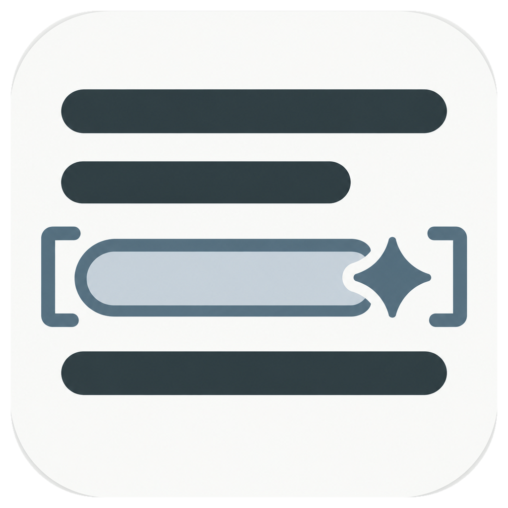

<p align="center">
  
</p>

<h1 align="center">LLM Reader</h1>

<p align="center">本地优先的 Windows 桌面阅读器：连续阅读，用原文核对每次理解。</p>

<p align="center">
  <a href="https://github.com/maaoding/llm-reader/releases/latest">下载 Windows x64 版本</a>
  ·
  <a href="https://llm-reader.maaoding.icu/">项目主页与交互演示</a>
  ·
  <a href="https://llm-reader.maaoding.icu/docs/">使用文档</a>
</p>

当前版本 **v1.3.0**：TXT Markdown 阅读与恢复优化。[发布说明](https://llm-reader.maaoding.icu/docs/releases/v1.3.0.html) · [更新日志](https://llm-reader.maaoding.icu/docs/changelog.html)

## 核心功能

- **连续阅读**：支持 EPUB、UTF-8 TXT 与 PDF，提供目录、书内搜索、摘录和阅读位置恢复。TXT 支持 Markdown 自动排版与按书切换。
- **有来源的问答**：选中原文即可提问；原文准备后可围绕整本书对话，或选择最多 5 本书比较观点。回答保留实际参考资料，有效引用可回到原文，未知引用标记为未验证。
- **笔记与归档**：按章节生成笔记，将有价值的回答保存到“问答集”，支持搜索、继续追问和 Markdown 导出。
- **按需增强**：支持助手设定、单轮联网搜索、PDF 图片提问，以及可选的 PDF 解析、逐页 OCR、Embedding 和 Rerank 服务。

书籍、进度、摘录、笔记和会话保存在本机，无需注册 LLM Reader 账号，不提供同步或遥测。普通阅读无需模型；AI 功能需自行配置服务，会发送所需文本、检索词、PDF 或图片，调用可能产生费用。凭据在本机加密保存，PDF 处理由你主动开始。

## 安装与使用

- 从 [GitHub Releases](https://github.com/maaoding/llm-reader/releases/latest) 下载 Windows x64 安装程序。安装包未签名，Windows 可能显示安全提示。
- 已有版本可在“设置 → 关于”检查更新，点击“重启并安装”，或退出后手动运行新安装器；本机书库和配置继续沿用。
- MOBI/AZW3 导入需本机已安装 [Calibre](https://calibre-ebook.com/)，仅支持无 DRM 文件。

导入书籍即可阅读。想使用 AI 时，先配置 OpenAI 兼容或 Anthropic / Claude 模型，再选中原文提问；整本书或多书问答需要先完成“本书准备 → 原文准备”。章节笔记和检索增强均为可选。

操作教程集中在[官网使用文档](https://llm-reader.maaoding.icu/docs/)：

- [快速开始](https://llm-reader.maaoding.icu/docs/getting-started.html)：从安装到第一次提问。
- [配置问答模型](https://llm-reader.maaoding.icu/docs/models.html)：地址、协议、测试与保存。
- [常见问题](https://llm-reader.maaoding.icu/docs/faq.html)：排查连接、原文准备与恢复问题。

## 源码开发

Node.js 范围与 pnpm 版本以 [package.json](package.json) 为准。

```powershell
pnpm install --frozen-lockfile
pnpm dev
```

构建、测试、打包和 CI 见[开发与验证](docs/development.md)。协议参考、产品约定、发布验收与官网文档维护入口统一收录在[仓库文档索引](docs/README.md)。

## 许可证

[GPL-3.0-or-later](LICENSE) · Copyright (C) 2026 wrh37。第三方许可见 [THIRD_PARTY_NOTICES.md](THIRD_PARTY_NOTICES.md)。
